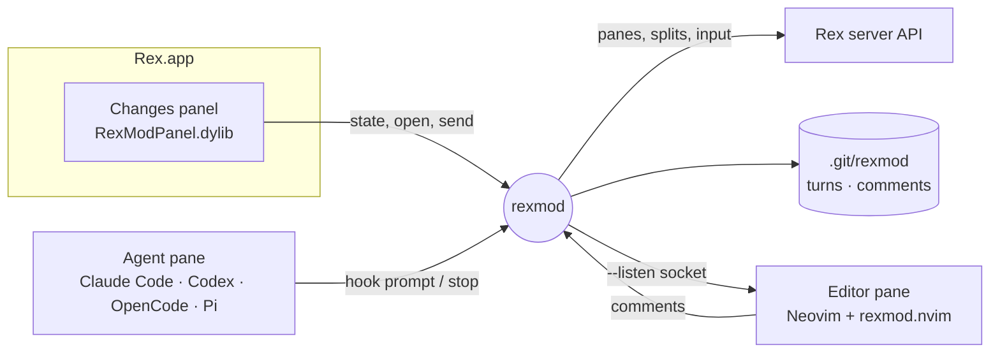

<div align="center">
  

  # rexmod

  *Turn [Rex](https://rex.superlogical.com) into a harness for your coding agent.*

  [](https://github.com/alpcanaydin/rexmod/actions/workflows/ci.yml)
  [](https://github.com/alpcanaydin/rexmod/releases)
  
  [](LICENSE)

  [The loop](#the-loop) • [Install](#install) • [Usage](#usage) • [How it works](#how-it-works) • [FAQ](#faq)
</div>

https://github.com/user-attachments/assets/ac2e4950-17d7-4bd9-b16a-9bd8cb463f49

<p align="center"><sub>One minute, sped up while the agent works. No player? <a href="assets/demo.mp4">Download the video</a>.</sub></p>

Rex already runs your agents. rexmod builds the harness around them: it records every turn, so you
see exactly what the agent changed; it opens a real editor beside the agent to read and review that
code; and it hands your review back to the agent as its next input. Prompt, change, review, feedback:
the whole loop stays in one Rex window, for Claude Code, Codex, OpenCode or Pi.

> [!NOTE]
> rexmod is an unofficial mod, not made by or affiliated with Superlogical. It patches your local copy
> of Rex so Rex loads the panel; the uninstaller puts the official build back.

## The loop

1. **Prompt.** Talk to your agent as usual. rexmod snapshots the working tree the moment you send.
2. **Change.** The *Changes panel* on the right, styled like Rex's own sidebar, fills in while the
   agent works. Its *Changes* tab shows *Last Turn*, exactly what this reply changed, next to
   *Uncommitted* (split into staged and unstaged) and *Branch*, as a list or a tree. The other tabs
   are *Info* (the agent's state and session, your plan usage, what runs in its pane and the ports it
   listens on) and a *Files* tree. The panel follows Rex's Interface style, Classic or Glass.
3. **Review.** Click a file and it opens in Neovim beside the agent, at the changed line, with LSP,
   completion and live diagnostics. `Space r` on a line or a selection leaves a review comment.
4. **Feedback.** Your comments ride along with your next message to the agent, or go right away
   from the panel. The agent answers them, and the next turn starts at step 2.

Around the loop:

- **Any language, on demand.** Open a Go, Rust, Python, Elixir… file and its tree-sitter parser and
  language server are installed (Mason) and started on the spot.
- **`⌘P` file picker** over the agent's repository, with the editor's syntax highlighting in the
  preview.
- **Several agents per tab.** The harness follows the agent you focused last; its name at the bottom
  of the panel is a menu to switch. A note always goes to the agent it was written for.
- **Media previews.** Images and PDFs open as pictures in the editor, videos show their first
  frame (`Space u o` plays them in the macOS app), and markdown renders in place, images included (`Space c p` opens a live browser preview).
- **The agent knows the harness.** Every agent gets the `rexmod` skill, so it can open a file for
  you in the editor pane (`rexmod open file:line`) when it points you at something.
- **Out of the way.** Hidden, the panel takes no space; the toggle sits with the pane actions,
  `⌘⇧E` from the keyboard. When Rex updates itself, rexmod re-applies the patch and asks you to
  reopen it.

| Agent | How the harness hooks in | Last Turn | Comments with your next message |
|---|---|:-:|:-:|
| Claude Code | `UserPromptSubmit` / `Stop` hooks | ✓ | ✓ |
| Codex | the same hooks (trust them once with `/hooks`) | ✓ | ✓ |
| OpenCode | server plugin + TUI plugin | ✓ | ✓ |
| Pi | extension | ✓ | ✓ |

## Install

You need a Mac with Apple silicon on macOS 15 or later, [Rex](https://rex.superlogical.com) installed
and opened once, and [Homebrew](https://brew.sh) (for Neovim, fzf and Node, if you don't have them).

With Homebrew:

```sh
brew trust --tap alpcanaydin/rexmod   # Homebrew asks you to trust third-party taps
brew install alpcanaydin/rexmod/rexmod
rexmod-setup
```

Or in one line:

```sh
curl -fsSL https://raw.githubusercontent.com/alpcanaydin/rexmod/main/install.sh | sh
```

Then quit Rex (`⌘Q`) and open it again. Nothing is compiled on your machine. After `brew upgrade
rexmod`, run `rexmod-setup` again.

<details>
<summary>What the installer does</summary>

- Copies rexmod into `~/Library/Application Support/rexmod` and links `~/.local/bin/rexmod`.
- Downloads the free [Flow Icons](https://github.com/thang-nm/Flow-Icons) pack for the file tree.
- Editor: with no `~/.config/nvim`, installs the bundled LazyVim config there; with a lazy.nvim
  config, adds one plugin spec (`lua/plugins/rexmod.lua`); with any other config, installs the bundled
  one as `~/.config/rexmod-nvim` and leaves yours alone.
- Adds `⌘P` to `~/.config/rex/init.lua` (in a managed block).
- Hooks into each agent it finds and installs the `rexmod` skill. JSON files are backed up first.
- Backs up the official Rex, patches it, and adds a LaunchAgent that re-patches after Rex updates.

Options: `--update-rex` installs the latest official Rex first, `--no-patch` skips the panel,
`--no-hooks` skips the agents. From a checkout, `./install.sh` builds what it needs if Go and Xcode
are there.
</details>

> [!IMPORTANT]
> Codex runs new hooks only after you trust them: start Codex and run `/hooks` once. OpenCode loads
> plugins when its background server starts, so quit OpenCode once after installing.

## Usage

| Where | Keys | What |
|---|---|---|
| Rex | `⌘⇧E` | Show or hide the panel |
| Rex | `⌘P` | Find a file in the agent's repository |
| Panel | click a file | Open it in the editor pane |
| Editor | `Space r` | Comment on the line, or on the selection in visual mode |
| Comment box | `Ctrl+S` / `Esc` | Save / cancel |
| Editor, on a noted line | `E` / `D` | Edit / delete that note |
| Editor | `]r` / `[r` | Next / previous comment |
| Editor | `Space R` | All comments of the repo: `Ctrl+S` sends pending ones, `Ctrl+X` deletes |

Pending comments head the panel's *Changes* tab, whose icon shows how many there are: click one to
open it in the editor, or send them all right away with *Send*. Otherwise they ride along with the
next message you type to the agent, as a short list of `file:line`, the code, and your note.

**Several agents in one tab.** The panel, Last Turn and your comments follow the agent pane you
focused last; working in the editor or a shell doesn't change that. The agent name at the bottom of
the panel becomes a menu to switch, and the *Info* tab lists them all.

### Remote hosts

A session on another machine's Rex server (`rex hosts`, reached over Tailscale) works too: the
panel finds which host the session is on and runs `rexmod` there, so git and the agent's hooks run
where the repository is. It does that through Rex itself: on the host, `rexmod serve` stays running
as a Rex client and answers the Mac's requests (`client.perform`), and it tells the panel the moment
a repository it was asked about changes, so the panel refreshes then instead of polling.

The host needs `rexmod`, `git` and Rex's `rex` CLI. Until there's an installer, build and copy
`rexmod` yourself:

```sh
GOOS=linux GOARCH=amd64 CGO_ENABLED=0 go build -o build/rexmod-linux-amd64 ./cmd/rexmod
scp build/rexmod-linux-amd64 my-gpu-box:.local/bin/rexmod
```

That's all: the first time the panel follows a session there, rexmod starts `rexmod serve` through
Rex, in a session called `rexmod` that has no window. Copy a new `rexmod` over it and the running
service exits within seconds; the next request starts the new one. The service runs only the
commands the panel needs (`target`, `state`, `info`, `files`, `follow`, `comments send`), for
whoever the host's Rex server lets in, which by default is only you.

If the service can't be used (an older `rexmod` there, a result over Rex's 1 MB message limit, Rex
trouble), rexmod falls back to ssh, which needs a login that doesn't prompt (a key). Say which ssh
destination each Rex host is in `~/.config/rexmod/config.json` (a host without an entry is reached at
its label; `rexmod` defaults to `~/.local/bin/rexmod` there). `"remote_channel": "ssh"` skips Rex
and always uses ssh, for troubleshooting:

```json
{ "remote_hosts": { "gpu2": { "ssh": "my-gpu-box" } }, "remote_channel": "ssh" }
```

The editor and `⌘P` aren't supported on remote hosts yet; Last Turn needs `rexmod hook prompt` /
`stop` in the host's agent hooks.

## How it works



- **The panel** is a Swift dylib. The installer adds a weak load command for it to Rex's executable and
  re-signs the app ad hoc. It insets Rex's own chrome and draws on Rex's backdrop, so it looks native.
- **`rexmod`**, a Go CLI, does the work: it finds the tab's agent pane through Rex's API, diffs git
  trees, opens files in the editor pane, and keeps comments.
- **Last Turn** comes from two snapshots of the working tree (written with a throwaway git index, so
  your index is untouched): one when you send a message, one when the agent finishes.
- **Comments** live in `.git/rexmod/` of the worktree, each tied to the agent pane it was written for.

## Updating and uninstalling

Updates: `brew upgrade rexmod && rexmod-setup`, or run the one-line install again.

Rex itself: Sparkle can't update a patched Rex (its installer only accepts an app signed by
Superlogical), so rexmod turns Sparkle's checks off and its LaunchAgent updates Rex instead, every
hour: it downloads the official build, checks its signature, Team ID and notarization, patches it
and asks you to reopen Rex. To do it now: `~/Library/Application\ Support/rexmod/scripts/update.sh`.


Uninstall, which restores the official Rex and removes the hooks, the `⌘P` block and the files:

```sh
~/Library/Application\ Support/rexmod/scripts/uninstall.sh
```

## FAQ

<details>
<summary>The panel doesn't show up</summary>

Check that Rex is patched: `~/Library/Application\ Support/rexmod/scripts/patch.sh --check`. If Rex
just updated, reopen it once the re-patch notification arrives. The panel logs to
`~/Library/Logs/rexmod-panel.log`; start Rex with `REXMOD_PANEL_DISABLE=1` to run it without the panel.
</details>

<details>
<summary>Last Turn stays empty</summary>

The agent's hooks aren't running. Run `~/Library/Application\ Support/rexmod/scripts/install-hooks.sh`
again, then for Codex trust the hooks with `/hooks`, and for OpenCode quit it once.
</details>

<details>
<summary>Do my comments go to an agent outside Rex?</summary>

No. A note is tied to the agent pane of the tab you wrote it in. An agent running elsewhere (another
terminal or app) in the same repository only gets notes written outside Rex.
</details>

<details>
<summary>Two Codex panes in the same repository</summary>

Codex runs its hooks in one background server for every pane, so rexmod finds the pane by looking
for the Codex that works in that folder. With two of them in the same repository it can't tell
which one sent the message, and rather than guess it leaves the notes pending and records the turn
without a pane. Send those notes from the panel's *Changes* tab: it pastes them straight into the
pane the panel follows. Claude Code, OpenCode and Pi don't have this limit.
</details>

<details>
<summary>Debugging the panel</summary>

Darwin notifications drive it from a shell: `notifyutil -p dev.rexmod.toggle` (also `.refresh`,
`.snapshot`, `.dumpviews`, `.dumpchrome`, `.dumpheader`, `.dumpsidebar`). Output lands in
`~/Library/Caches/rexmod/`.
</details>

## Development

`make build`, `make panel`, `make test`, `make lint`. See [CONTRIBUTING.md](CONTRIBUTING.md) for the
setup and how the pieces fit together.
